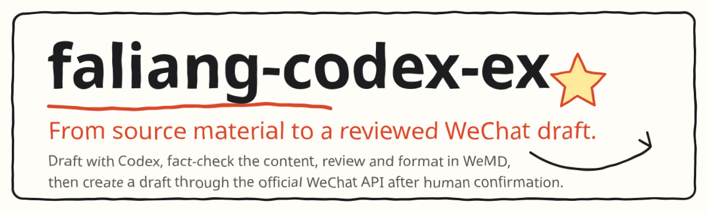

<div align="center">

<picture>
  <source media="(prefers-color-scheme: dark)" srcset="docs/assets/hero.svg">
  
</picture>

**WeChat Writing Workflow.** Connect the steps from source material to a reviewed WeChat draft.

[HRouter](https://hrouter.net/home) · [WeMD](https://github.com/tenngoxars/WeMD) · [All public projects](https://github.com/honestTai)

**English** · [简体中文](README.zh-CN.md)

</div>

## ❤️ Sponsor

| Sponsor | What it is |
| :--- | :--- |
| [](https://hrouter.net/home) | **[HRouter](https://hrouter.net/home)**: model access, API key management, and usage tracking for AI coding and application development. Also operated by the maintainer. |

## 🚀 Quick start

You need Node.js 20+, Codex, the local WeMD client, and a WeChat Official Account with access to the draft API.

```text
Sources → Codex draft → Fact-check → Cover and images → WeMD review → HTML → WeChat draft box
```

```powershell
npm install
Copy-Item .env.example .env
```

Configure locally:

```text
WECHAT_APPID=
WECHAT_SECRET=
PUBLIC_ACCOUNT_AUTHOR=
PUBLIC_ACCOUNT_SOURCE_URL=
```

Never commit `.env`. API access can also depend on account permissions, verification status, and an IP allowlist.

```powershell
npm.cmd run article:new -- --title "Article title" --slug article-slug
npm.cmd run handoff:wemd -- articles/drafts/article-slug.md
npm.cmd run render:wechat-html -- --article articles/approved/article-slug.md
npm.cmd run preview:wechat -- --article articles/approved/article-slug.md
npm.cmd run publish:draft -- --article articles/approved/article-slug.md --cover assets/covers/article-slug.jpg --confirmed
```

The file is created at `articles/drafts/article-slug.md`. Draft creation is restricted to `articles/approved/` and requires human confirmation. This creates a draft, not a broadcast.

```powershell
npm.cmd run check
```

## ✨ Features

| Feature | What this repository contains |
| :--- | :--- |
| Writing and review | Reusable workflows, scripts, and prompts for writing and review. |
| WeMD handoff | Local WeMD handoff with embedded images to reduce missing-image problems. |
| WeChat HTML | WeChat-ready HTML with inline styles. |
| Draft box | Draft-box creation through the official WeChat API; **not a mass-publishing workflow**. |

For WeChat Official Account authors who want to keep editorial and layout review in the workflow.

This repository does not supply article topics, account-specific content templates, or articles waiting to be published. Keep real drafts and final articles in your own writing repository.

## 📚 Docs

- [Codex 写稿提示词](prompts/codex-writing.md)
- [WeMD 审稿提示词](prompts/wemd-review.md)
- [Codex + WeMD HTML + 微信官方接口发布提示词](prompts/wechat-publish.md)
- [内容分流流水线](workflow/CONTENT_PIPELINE.md)
- [完整工作流](workflow/WORKFLOW.md)
- [公众号草稿底部设置](workflow/WECHAT_DRAFT_SETTINGS.md)
- [Codex 版公众号主流程](workflow/CODEX_BLOGGER_WORKFLOW.md)
- [上游元数据记录](workflow/SOURCES.md)

[WeMD](https://github.com/tenngoxars/WeMD) provides the review editor. This repository retains minimal upstream metadata and license information; obtain the complete source upstream.

## 📄 License

[MIT](LICENSE). Copyright (c) 2026 faliang.

## 📈 Star history

<a href="https://www.star-history.com/#honestTai/faliang-codex-ex&Date">
  <picture>
    <source media="(prefers-color-scheme: dark)" srcset="https://api.star-history.com/svg?repos=honestTai/faliang-codex-ex&type=Date&theme=dark">
    
  </picture>
</a>

---

<div align="center">

Made by **[honestTai](https://github.com/honestTai)** · [HRouter](https://hrouter.net/home) · [More projects](https://github.com/honestTai)

**Star the project if it helps, and share your ideas in Issues.**

</div>
